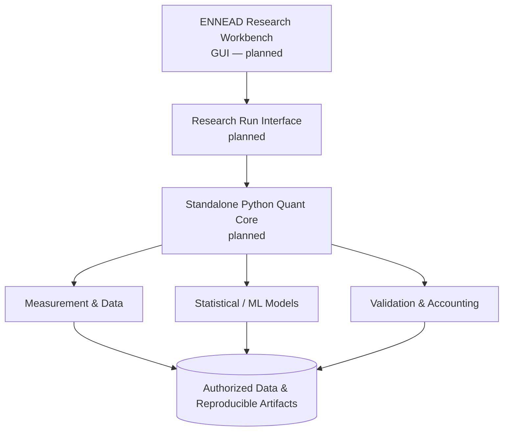

# Quant Research Lab

**An independent quantitative-finance and machine-learning research program.**

[Explore the project roadmap](./docs/ROADMAP.md) · [Architecture](./docs/ARCHITECTURE.md) · [Research principles](./docs/RESEARCH_PRINCIPLES.md) · [Public disclosure policy](./docs/PUBLIC_DISCLOSURE.md)

> **Status (October 2026):** research architecture established; first measurement/accounting diagnostic specified **conditionally**, but **not activated**. No real-data pilot, trained trading model, backtest result or live execution is being claimed.

## Northstar

Develop an independently reproducible research environment that connects quantitative-finance research, measurement integrity, statistical/ML models, systematic hypothesis evaluation, and — **only if independently justified** — controlled trading operations.

The objective is **not** to showcase a profitable algorithm. The objective is to demonstrate how an evidence-driven research system is designed, built, scrutinized and improved.

## Project ladder

| # | Workstream | Status |
|---|---|---|
| 01 | Research foundation and falsification architecture | **Designed** |
| 02 | First bounded historical diagnostic contract | **Conditionally designed** |
| 03 | Python data and accounting core | **Next: not yet implemented** |
| 04 | ENNEAD research workbench integration | Planned |
| 05 | Statistical baselines and ML models | Planned |
| 06 | Hypothesis- and mechanism-led strategy research | Planned |
| 07 | Confirmatory validation and execution realism | Planned |
| 08 | Paper operation | Conditional future stage |
| ★ | Continually evaluated research platform | Long-term northstar |

See [detailed roadmap and exit criteria](./docs/ROADMAP.md).

## System design (proposed)



The diagram represents **design intent**, not implemented system components.

## Try a real piece of code today (synthetic only)

This showcase includes an **independent offline synthetic accounting demonstrator**. It illustrates share-split value preservation, dividend receivable/payment accounting, and explicit transaction fees. It is not a trading engine or implementation of the private pilot.

```bash
python examples/synthetic_accounting/demo.py
python -m unittest discover -s examples/synthetic_accounting -p 'test_*.py' -v
```

No credentials, data downloads or external libraries are required. All instruments and prices in this example are fictional.

## Why public vs private?

This repository communicates the project structure and publishes small generic demonstrations. Private research materials, strategy hypotheses, commercial datasets, parameters, trained weights, provider keys and internal implementation details are **not** included. See [publication rules](./docs/PUBLIC_DISCLOSURE.md).

## Research stance

No reported profits, not an investment service, no financial advice. In financial ML, an attractive historical result is a hypothesis to scrutinize — not proof of future performance.

## Implementation & contribution note

Development is supported by AI coding/research tools. Scientific specification, acceptance criteria, validation decisions and project ownership remain human responsibilities. Specific implementations and contributions will be documented as real functionality is delivered.

## View as a website

The companion [static project presentation](./index.html) can be published with GitHub Pages, with no backend or licensed-data dependencies. Instructions: [Publishing checklist](./docs/PUBLISHING.md).