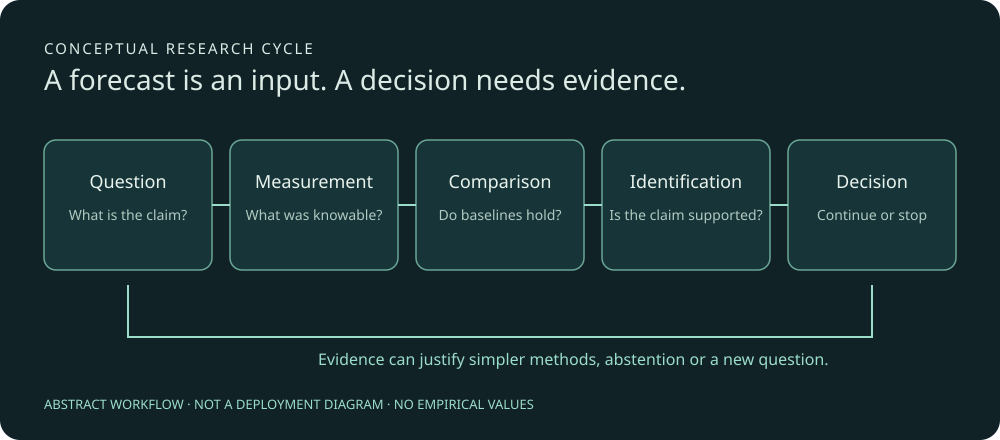

# Public research view

The illustration is an abstract scientific workflow, not private deployment topology. This repository contains a static FX case study, selected aggregates, an independent plot renderer and fictional accounting software. It does not distribute the private research engine.

The evidence chain distinguishes source integrity, transformations, frozen comparisons, measured forecasts, independent recalculation and proportional conclusions. Public reproduction begins at aggregates and has a narrower boundary than the private audit chain.

Workbench integration and adaptive research capability remain aspirations. No autonomous strategy selection, trading system or economic-performance claim is presented as delivered functionality.
