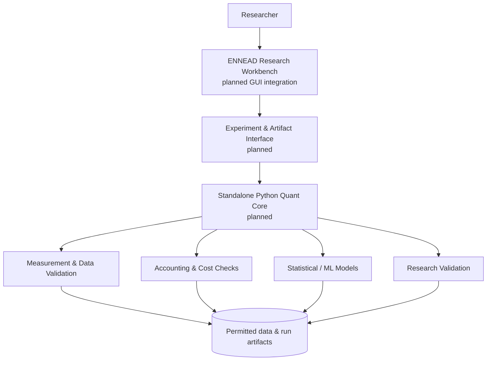

# Architecture · Public Overview

The goal is to separate the *research computation* from the *research user interface*.

This is **target architecture, not a diagram of shipped software**.

## Architectural principles

- **Independence:** numerical code should run, test and reproduce without the graphical application.
- **Explicit evidence:** data provenance, experiment configuration and evaluation boundaries must be inspectable.
- **Proportional complexity:** avoid building production/live infrastructure for a measurement pilot.
- **Modular trust boundary:** confidential datasets, internal hypotheses, keys and potentially proprietary models are never imported into this public repository.
- **Stage discipline:** exploratory diagnostics are not confirmatory evidence of economic value.

## ENNEAD relationship

ENNEAD is envisioned as a wider personal research/workspace environment. The trading integration is **planned**; the private ENNEAD application's complete code is not part of this showcase. The public site may eventually feature real sanitized screenshots when the corresponding features exist.
